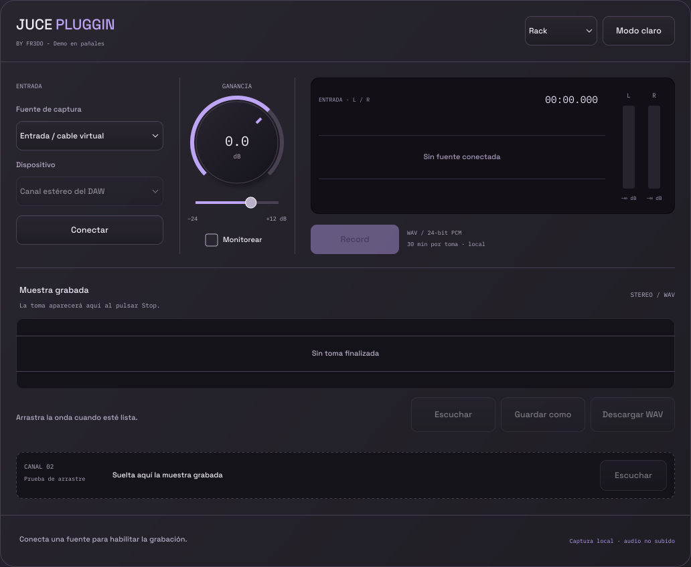

# JUCE PLUGGIN

**BY FR3DO 
**BY FR3DO 
**BY FR3DO 
**BY FR3DO 
**BY FR3DO 
**BY FR3DO 


Grabador de muestras estéreo para usar como efecto dentro de un DAW. Recibe
el audio del canal, aplica ganancia, permite monitorear y escribe la toma
en un WAV 24-bit PCM. Al terminar, muestra la onda debajo de la captura
y permite guardar el archivo o arrastrarlo a otra pista.

- [Descargar demo VST3 para Windows x64](https://nicolas-cortez.vercel.app/software/juce-pluggin/JUCE-PLUGGIN-Windows-x64-Demo.zip)
- [Probar la demo web](https://nicolas-cortez.vercel.app/software/juce-pluggin/index.html)
- [Fuentes de la entrega Windows, con JUCE 7.0.12](https://nicolas-cortez.vercel.app/software/juce-pluggin/LoopCapture-JUCE-Source.zip)
- [Instalación y ruteo en FL Studio](INSTALL-WINDOWS.md)

El plugin nativo no necesita navegador. En Windows, el audio del sistema puede capturarse directamente con WASAPI loopback.
También se puede conectar al DAW mediante un cable virtual o una entrada del driver.
**Conexiones** abre una ventana adicional que enumera salidas de Windows,
entradas físicas y controladores MIDI detectados, estado de conexión y niveles L/R. Desde allí
puedes elegir y conectar una salida para samplear aplicaciones como MPC en
modo Windows Audio compartido. Las entradas de una interfaz se seleccionan
en el DAW: el plugin no controla el driver de FL Studio.
La ventana **Conexiones** permite asignar una **nota MIDI** o un **CC MIDI**
para alternar Record / Stop. El DAW debe enviar esos mensajes al efecto; la
asignación se guarda en el proyecto del DAW. El CC responde al cruce de valor
menor que 64 a valor 64 o superior, útil para un botón o pedal; libéralo antes
de volver a dispararlo. Por defecto ambos controles están desactivados.
MPC, Maschine y otros controladores aportan MIDI para controlar la toma; su
audio requiere una conexión independiente al DAW o a una salida Windows
compartida. Esta opción no sincroniza el reloj del plugin con el transporte.
La demo web usa los permisos de captura del navegador.

**Estado:** VST3 Windows x64 compilado y verificado; pendiente de probar en
FL Studio. macOS VST3/AU tiene configuración de compilación, pero esta entrega
no incluye un binario Mac probado con un DAW. [Validaciones y límites](VALIDATION.md).

## Código y compilación

Nombre visible del plugin: **JUCE PLUGGIN**. El icono original está en
`Assets/juce-pluggin-icon.png`, incluido en los recursos de la aplicación Standalone.
La cabecera muestra el nombre del producto y **BY FR3DO - Demo en pañales**. Los nombres internos de targets CMake y clases
conservan `LoopCapture` para mantener los comandos de compilación existentes.

Plugin de efecto estéreo C++20 / JUCE, orientado a capturar audio en tiempo real,
ver la forma de onda y arrastrar el WAV terminado hacia un DAW. VST3 en Windows
y macOS; AU en macOS. Incluye una aplicación Standalone opcional para comprobar
el ruteo de dispositivos.

El binario Windows de prueba y su instalación están descritos en
`INSTALL-WINDOWS.md`. El plugin recibe audio del canal del DAW y no abre el navegador.

## Archivos del proyecto

| Archivo | Función |
| --- | --- |
| `CMakeLists.txt` | `juce_add_plugin`, JUCE fijado a una versión, formatos y pruebas |
| `Source/PluginProcessor.h/.cpp` | APVTS, ganancia, passthrough, grabación, thumbnail y estado |
| `Source/PluginEditor.h/.cpp` | Interfaz de la web en JUCE, medidores, Timer y arrastre nativo |
| `Source/CaptureCore.h` | Cola SPSC preasignada y protocolo de exclusión al terminar una toma |
| `Tests/CaptureCoreTests.cpp` | Orden estéreo, wrap, overflow y Stop concurrente |
| `Tests/CaptureIntegrationTests.cpp` | WAV real, ganancia, monitor, estado y ciclo de vida JUCE |
| `.github/workflows/build.yml` | Windows JUCE 7.0.12 / macOS JUCE 8.0.6 |
| `VALIDATION.md` | Resultados y alcance de las comprobaciones ejecutadas |

## Flujo de audio

1. La aplicación que produce audio envía su salida al bus virtual.
2. El DAW selecciona ese bus como **entrada** de una pista estéreo.
3. JUCE PLUGGIN se inserta como efecto en esa pista.
4. `processBlock` aplica la ganancia de entrada, actualiza peaks y copia audio
   a la cola de grabación cuando la toma está activa.
5. El worker escribe el WAV y agrega datos a `AudioThumbnail`.
6. El monitoreo aplica una rampa independiente a la salida del plugin.
7. Stop excluye productores nuevos, espera que termine cualquier copia en curso,
   drena la cola y cierra el WAV. Solo entonces el archivo puede arrastrarse.

**Fuente Entrada del DAW:** el plugin recibe audio del host. **Audio sistema
(Windows):** un worker WASAPI captura la salida seleccionada y entrega muestras
al callback mediante una cola preasignada. No se abre un `AudioDeviceManager` dentro del plugin; el DAW administra
el dispositivo y el reloj. La aplicación Standalone sí tiene selección de audio
mediante el wrapper de JUCE.

## Grabación y seguridad del hilo de audio

- Formato: WAV **24-bit PCM**, estéreo, a la frecuencia del DAW. Cumple la
  alternativa de 24 bits del requerimiento; no se ofrece un selector 32-bit float.
- La ganancia es automatizable: `inputGain`, -24 a +12 dB, default 0 dB,
  suavizada en 15 ms. `monitor` también usa APVTS, default desactivado y rampa de 5 ms.
- `midiNote` y `midiCc` se guardan en APVTS; el plugin declara entrada MIDI
  al host. El callback solo solicita alternar la toma con un contador atómico;
  el worker inicia o cierra el WAV aunque el editor esté cerrado. Los mensajes
  MIDI recibidos se consumen, no se reenvían a instrumentos posteriores.
- La grabación es **posterior a Input Gain y anterior al mute de Monitor**.
  El audio por encima de 0 dBFS satura al convertirse a PCM; el indicador CLIP
  queda visible un segundo. Reduce Input Gain si aparece.
- `processBlock` no abre archivos, no usa mutexes, no espera al worker, no manda
  mensajes al UI y no crea buffers. Las operaciones atómicas requeridas tienen
  comprobación `is_always_lock_free` en compilación.
- La cola ocupa 4 MiB: 524288 frames estéreo float, aproximadamente 10.9 segundos
  a 48 kHz o 2.7 segundos a 192 kHz. El worker usa bloques preasignados de 8192
  frames y espera hasta 5 ms cuando la cola está vacía.
- La implementación usa `juce::Thread` + cola circular + `AudioFormatWriter`,
  la alternativa al `ThreadedWriter`/`TimeSliceThread` indicada en el requerimiento.
  Hay un único productor y un único consumidor por instancia.
- El worker es el único propietario del writer. El protocolo `SessionGate`
  evita destruir o resetear recursos mientras una copia antigua sigue en curso.
  Stop funciona incluso cuando el host deja de llamar a `processBlock`.
- Un bloque que no cabe en la cola se rechaza completo, se detiene la toma y se
  informa overflow. No se continúa pegando bloques posteriores: el WAV disponible
  representa el prefijo continuo de la toma. Un fallo de escritura deshabilita
  exportar ese archivo. El límite es 30 minutos por toma o el máximo RIFF seguro.
- Cambiar la configuración del motor, hacer bypass o liberar recursos termina
  la toma. Los callbacks marcados como offline no se graban. El detector offline
  depende de que el host comunique correctamente su modo de render.
- Cerrar el editor no detiene la toma. Destruir el procesador sí drena y cierra
  el archivo; el host debe haber detenido sus callbacks antes de destruirlo.
- Los mutexes de metadata y thumbnail solo los usan el worker y el UI, nunca
  el callback de audio. El Timer funciona a 60 Hz; los medidores repintan a esa
  tasa y el waveform a 30 Hz, en sus propios rectángulos.
- Los medidores son **peak meters**, no VU/RMS calibrados. Tienen ataque
  inmediato, caída de 26 dB/s y escala de -72 a 0 dBFS. La telemetría puede
  coalescer un peak simultáneo al tick del UI; el audio usa orden estricto SPSC.

## Compilación: requisitos

- CMake 3.22 o superior, Git y toolchain C++20 de 64 bits.
- Windows: Visual Studio 2022 / Build Tools, carga **Desktop development with C++**
  y Windows SDK. VS Code es el editor; necesita igualmente MSVC.
- macOS: Xcode y herramientas de línea de comandos (`xcode-select --install`).
- Primera configuración con internet: FetchContent descarga JUCE **7.0.12**.
  El SDK VST3 viene incluido con JUCE; AU usa los SDK de Apple.

No necesitas Projucer. Los comandos se ejecutan desde la raíz de este repositorio (en el ZIP de fuentes, desde la carpeta `LoopCapture`).
Este repositorio obtiene JUCE 7.0.12 mediante FetchContent. El ZIP de fuentes
enlazado arriba incluye `vendor/JUCE` (7.0.12), que CMake utiliza por defecto
sin descargarlo. Para otra versión deja `LOOPCAPTURE_JUCE_PATH` vacío y configura
`-DLOOPCAPTURE_JUCE_TAG=8.0.6`, o indica un checkout con `LOOPCAPTURE_JUCE_PATH`.

### Windows / Visual Studio / VS Code

Abre PowerShell o Developer PowerShell de VS 2022:

```powershell
cmake -S . -B build-win -G "Visual Studio 17 2022" -A x64
cmake --build build-win --config Release --parallel 2
ctest --test-dir build-win -C Release --output-on-failure
```

En VS Code instala **C/C++** y **CMake Tools**, abre esta carpeta, ejecuta
**CMake: Select a Kit** → Visual Studio x64, **CMake: Configure** y **CMake: Build**.
Si usas Ninja desde Developer PowerShell:

```powershell
cmake -S . -B build-ninja -G Ninja -DCMAKE_BUILD_TYPE=Release
cmake --build build-ninja --parallel 2
```

### macOS / Xcode

```bash
cmake -S . -B build-mac -G Xcode -DLOOPCAPTURE_JUCE_PATH="" -DLOOPCAPTURE_JUCE_TAG=8.0.6 -DCMAKE_OSX_DEPLOYMENT_TARGET=11.0
cmake --build build-mac --config Release --parallel 2
ctest --test-dir build-mac -C Release --output-on-failure
open build-mac/LoopCapture.xcodeproj
```

Para un binario universal, configura desde una carpeta nueva:

```bash
cmake -S . -B build-universal -G Xcode \
  -DLOOPCAPTURE_JUCE_PATH="" -DLOOPCAPTURE_JUCE_TAG=8.0.6 \
  -DCMAKE_OSX_ARCHITECTURES="arm64;x86_64" \
  -DCMAKE_OSX_DEPLOYMENT_TARGET=11.0
cmake --build build-universal --config Release --parallel 2
```

En Xcode selecciona el scheme `LoopCapture_VST3` o `LoopCapture_AU`. Para
debuggear un plugin selecciona el ejecutable de tu DAW en **Edit Scheme → Run**.

### CLion

Abre `CMakeLists.txt` como proyecto. Usa un toolchain MSVC en Windows o Apple Clang
en macOS y un perfil CMake Release/Debug. Construye `LoopCapture_VST3` y, en macOS,
`LoopCapture_AU`. Puedes ejecutar `LoopCapture_Standalone` para probar entradas
sin un DAW. Para depurar dentro del host, usa una configuración que lance el DAW
o adjunta el depurador a su proceso/bridge correspondiente.

### JUCE local, JUCE 7 y opciones

```bash
cmake -S . -B build-local -DLOOPCAPTURE_JUCE_PATH=/ruta/absoluta/a/JUCE
cmake -S . -B build-juce7 -DLOOPCAPTURE_JUCE_TAG=7.0.12
```

Usa carpetas de build distintas al cambiar versión/toolchain. La compatibilidad
de código abarca JUCE 7.0.12 y 8.0.6; la matriz CI incluida usa JUCE 7.0.12 en Windows y JUCE 8.0.6 en macOS.

| Opción | Valor por defecto | Uso |
| --- | --- | --- |
| `LOOPCAPTURE_JUCE_TAG` | `7.0.12` | Versión descargada |
| `LOOPCAPTURE_JUCE_PATH` | vacío | Checkout local, evita descarga |
| `LOOPCAPTURE_BUILD_TESTS` | `ON` | Core y pruebas JUCE |
| `LOOPCAPTURE_CORE_TESTS_ONLY` | `OFF` | Pruebas portables sin JUCE |
| `LOOPCAPTURE_STANDALONE` | `ON` | Aplicación para probar ruteo |
| `LOOPCAPTURE_COPY_PLUGIN` | `OFF` | Copia a ruta de plugins de JUCE tras build |

Puedes compilar solo el formato necesario:

```bash
cmake --build build-win --config Release --target LoopCapture_VST3
cmake --build build-mac --config Release --target LoopCapture_AU
```

## Instalación

En generadores multiconfiguración, como Visual Studio/Xcode:

- VST3: `build-*/LoopCapture_artefacts/Release/VST3/JUCE PLUGGIN.vst3`
- AU: `build-*/LoopCapture_artefacts/Release/AU/JUCE PLUGGIN.component`
- Standalone: `build-*/LoopCapture_artefacts/Release/Standalone/`

En Ninja/Makefiles puede omitirse la carpeta `Release` en la ruta de artefactos.
**Copia el bundle completo**, no solamente su DLL/binario interior.

| Sistema | Destino |
| --- | --- |
| Windows VST3 | `C:\Program Files\Common Files\VST3\` |
| macOS VST3 | `~/Library/Audio/Plug-Ins/VST3/` |
| macOS AU | `~/Library/Audio/Plug-Ins/Components/` |

Windows puede requerir permisos al copiar a Program Files. Usa la carpeta VST3
estándar indicada arriba. En FL Studio abre
**Options → Manage plugins**, verifica la ruta y ejecuta **Find installed plugins**.
En macOS reinicia el host después de instalar. La distribución a otros equipos
requiere tratar firma/notarización por separado; este proyecto genera los bundles
para desarrollo y prueba local.

## Ruteo concreto con FL Studio

### Windows / VB-Audio Cable

1. Configura la aplicación fuente para reproducir hacia **CABLE Input**.
   Aunque su nombre diga Input, es el dispositivo de reproducción del cable.
2. En FL Studio abre **Options → Audio settings** y selecciona **FL Studio ASIO**.
3. En su panel elige **CABLE Output** como entrada y tus parlantes/interfaz como
   salida. FL Studio ASIO permite elegir una entrada y salida de dispositivos
   diferentes. Si prefieres ASIO4ALL, habilita el cable y la salida física.
4. Selecciona una pista del Mixer distinta de Master; en su menú **IN** selecciona
   el par estéreo correspondiente al cable. Inserta JUCE PLUGGIN en un slot FX.
5. Reproduce audio en la aplicación fuente. Los dos medidores deben moverse.
6. Pulsa **Record**, espera que cambie a **Stop** y captura la toma. Pulsa Stop,
   espera que se cierre el archivo y arrastra el panel de waveform a la Playlist
   o al área que admite archivos de un Sampler.

### macOS / BlackHole o Loopback

1. Envía la salida de la aplicación fuente a BlackHole 2ch o al dispositivo
   virtual que configuraste en Loopback.
2. Si necesitas combinar entrada virtual y salida física, crea un **Aggregate
   Device** en Audio MIDI Setup con ambas. Mantén una frecuencia compatible y
   usa drift correction en el dispositivo que no sea reloj principal.
3. Selecciona ese dispositivo en el DAW, elige los canales virtuales de entrada
   de la pista y asigna la salida Master a los parlantes/interfaz.
4. Inserta el plugin estéreo y sigue Record → Stop → arrastrar waveform.

Mantén la salida del DAW en el dispositivo físico: enviarla de regreso al mismo
cable que estás capturando crea realimentación. Si el DAW también graba su entrada,
no necesitas activar esa función para el grabador interno de JUCE PLUGGIN.

## Drag and drop y conservación de las tomas

- Se usa `DragAndDropContainer::performExternalDragDropOfFiles` desde `mouseDrag`,
  con un umbral de 6 px y `canMoveFiles=false`. Es un **arrastre nativo de archivos**.
- La ruta de la toma se fija al hacer mouseDown. Una toma nueva no elimina
  archivos previos; cambiar de toma no invalida un arrastre iniciado.
- Cada archivo usa un UUID y queda en `tempDirectory/LoopCapture`. El plugin
  no lo elimina al cerrar; evita que un host que importa por referencia lo pierda.
- **Copia/importa la muestra a la carpeta de tu proyecto del DAW.** La carpeta
  temporal puede limpiarse por el sistema. `Guardar como` permite copiarla a una ubicación permanente. La limpieza de tomas viejas es manual en esta versión.
- El estado del proyecto serializa ganancia/monitor mediante APVTS. No serializa
  el audio ni reabre automáticamente una toma temporal al cargar el proyecto.
- El host y su wrapper deciden qué destinos aceptan un WAV y cómo lo importan.
  Si el arrastre no funciona, usa `Guardar como` e importa el archivo desde el host.
  Ejecuta host y explorador con el mismo nivel de permisos en Windows.
- El límite de render y frecuencia es por instancia; pueden coexistir varias
  instancias con sus propias colas, worker y archivos.

## Comprobación manual en el DAW

1. Señal conocida (p. ej. tono estéreo a -12 dBFS): medidores L/R activos.
2. Graba 10 s y detén: WAV estéreo a la frecuencia del motor, duración cercana
   a 10 s y contenido audible. El inicio/fin se cuantiza a los callbacks del host.
3. Apaga Monitor: tras 5 ms la salida queda silenciada, pero el WAV conserva
   el audio. Automatiza Input Gain y comprueba el cambio en la siguiente toma.
4. Stop con transporte detenido: el archivo termina de cerrarse sin requerir
   otra llamada a `processBlock`.
5. Cierra/reabre la ventana mientras graba: la toma continúa.
6. Arrastra a Playlist y Sampler; guarda el proyecto copiando su audio a su carpeta.
7. Repite a 44.1/48/96 kHz, bloques de 64/256/1024, varias instancias y cambio
   del motor de audio. Bypass/release deben terminar la toma sin crash.

Si los medidores no se mueven, revisa la entrada estéreo de la pista, la salida
de la aplicación fuente y la suspensión automática de plugins del host.
Recibir silencio desde un cable correctamente conectado sí produce un WAV
silencioso válido; el plugin no puede distinguirlo de una fuente intencionalmente muda.

## Pruebas

```bash
cmake -S . -B build-core -DLOOPCAPTURE_CORE_TESTS_ONLY=ON
cmake --build build-core
ctest --test-dir build-core --output-on-failure
```

Las pruebas de integración se construyen en una configuración normal con JUCE.
GitHub Actions compila y prueba Windows con JUCE 7.0.12 y macOS con JUCE 8.0.6.
El resultado de cada ejecución se consulta en Actions; incluir el workflow
no significa que todas las compilaciones ya hayan pasado.

## Referencias oficiales

- JUCE CMake: https://github.com/juce-framework/JUCE/blob/master/docs/CMake%20API.md
- WAV writer: https://docs.juce.com/master/classjuce_1_1WavAudioFormat.html
- AudioThumbnail: https://docs.juce.com/master/classjuce_1_1AudioThumbnail.html
- Arrastre nativo: https://docs.juce.com/master/classjuce_1_1DragAndDropContainer.html
- Entradas FL Studio: https://www.image-line.com/fl-studio-learning/fl-studio-online-manual/html/recording_audio.htm
- Configuración FL Studio: https://www.image-line.com/fl-studio-learning/fl-studio-online-manual/html/envsettings_audio.htm
- VB-Cable: https://vb-audio.com/Cable/VBCABLE_ReferenceManual.pdf
- BlackHole: https://existential.audio/blackhole/support/
- Aggregate Device: https://support.apple.com/guide/audio-midi-setup/set-aggregate-device-settings-ams094c7edb4/mac

Esta demo usa la vía GNU GPL v3 de JUCE 7.0.12 y del SDK VST3. El paquete
de fuentes incluye JUCE completo en `vendor/JUCE`; consulta `LICENSE.txt`
y `THIRD-PARTY-NOTICES.md`. JUCE 8.0.6 sigue siendo una opción de compilación;
para distribuir esa variante se deben respetar sus términos, incluida su vía AGPLv3.

## Interfaz y exportación de muestras

- `Interfaz: Rack / Mesa` permite comparar el control de ganancia con perilla
  o con fader. La ventana no cambia de tamaño al iniciar/finalizar una toma.
- `Modo claro / Modo oscuro` cambia la paleta de cada instancia del editor.
- La onda de la toma finalizada aparece en un componente independiente debajo
  de la captura. Arrastra esa onda a Playlist, Sampler u otro destino que admita
  arrastre nativo de archivos; el plugin entrega el WAV cerrado, no datos internos JUCE.
- `Guardar como` abre un selector de carpeta/nombre y copia el WAV finalizado
  en un hilo de fondo. El callback de audio no realiza ese trabajo.
- Las tipografías Space Grotesk e IBM Plex Mono se incrustan en el binario,
  sin requerir instalación en el sistema. Sus licencias OFL están en `Assets/Fonts`.
- La preescucha de tomas y CANAL 02 también están disponibles en el editor nativo.
  CANAL 02 acepta un WAV arrastrado para comprobar el flujo de muestras.

## Interfaz nativa actualizada



El VST3 reproduce la estructura y la paleta de la demo web: entrada, dial y rango
de ganancia, consola estéreo con reloj y medidores, onda de la toma finalizada,
Escuchar, Guardar como, Descargar WAV y CANAL 02 para probar el arrastre. Tiene
Rack/Mesa y modo claro/oscuro, en un lienzo estable de 1032 × 848 unidades lógicas.
El host adapta esas unidades a su escala DPI; el editor no cambia de tamaño al
actualizar medidores ni al alternar la vista.

Pulsa Conectar para habilitar la grabación. En modo DAW el dispositivo/cable se
configura en el Mixer; en modo Audio sistema el selector enumera salidas Windows. La captura
nativa permite hasta 30 minutos por toma. Descargar WAV y Guardar como exportan
el archivo con el selector nativo. No abren un navegador.

La preescucha usa una cola SPSC y lectura/resampling en el worker. Se mezcla
después de grabación y Monitor, y no se incorpora a la toma. Se detiene al
iniciar otra grabación, cambiar el motor, hacer bypass o cerrar el editor.
Space Grotesk se incrusta como instancia estática de peso 500 para conservar
el aspecto de la web también con el renderizador GDI de Windows.

## Audio del sistema en Windows (1.1)

Selecciona **Audio sistema (Windows)** y una salida real de Windows, pulsa
Conectar y reproduce audio en ese dispositivo. Captura mediante WASAPI loopback,
sin navegador, cable virtual ni depender de un modelo de tarjeta. La entrada del
DAW sigue disponible como fuente independiente. [Uso, pruebas y alcance](SYSTEM-AUDIO.md).
